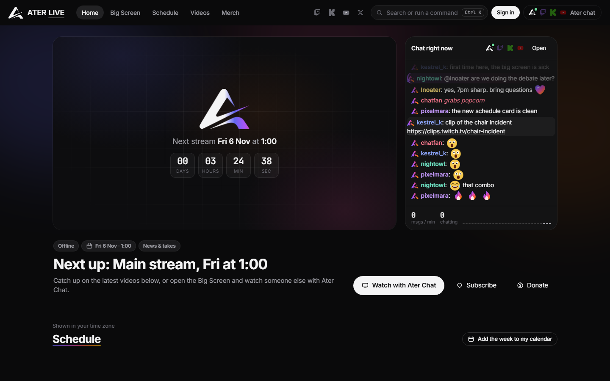
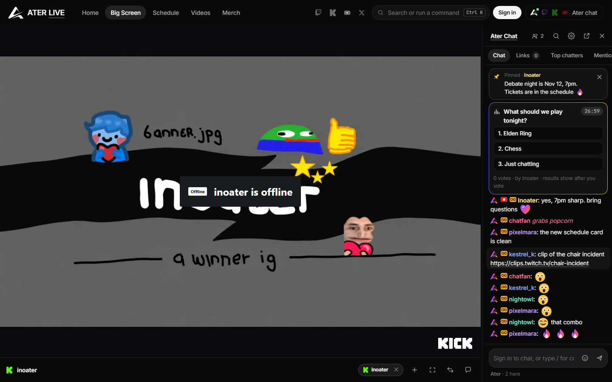
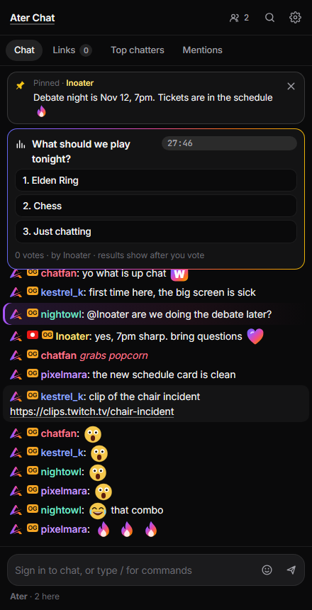

<p align="center"></p>

<h1 align="center">Ater Live</h1>

<p align="center">A streamer's home on the web, with its own chat.<br>
The stream, Ater Chat, the schedule and the archive in one place. Twitch, Kick and YouTube chatters can join the chat when you switch them on.</p>



## What's in it

**Home page.** A big stream card shows a muted live preview when you're live, and a countdown to the next scheduled stream when you're not. Beside it, the chat right now with messages per minute. Below that: the weekly schedule in each visitor's own time zone, upcoming events with *Add to calendar*, videos (uploads, appearances, clips), the chat leaderboard, merch and an about section.

**Big Screen.** Watch any Twitch, Kick, YouTube, Rumble or AngelThump stream next to the chat. Keep several streams on a strip and switch between them, use theater mode, swap sides, and resize the chat. You can share a layout as a link (`#/bigscreen?s=kick:name,twitch:name`).

- **Ater pick.** While the broadcaster is offline, a moderator can pick a stream for everyone (★ in the stage bar, or `/feature kick name`).
  - It becomes the Big Screen default for everyone "following Ater".
  - On the home page it plays dimmed behind the countdown, and brightens when you hover.
  - When the broadcaster goes live, they take over again.
- **Guest chat.** Watching someone else's Twitch or Kick stream? The chat offers to bring in *their* chat too.
  - It's dimmed and on a dashed rail, marked with their name.
  - A bar switches between Everyone, Ater only and the guest.
  - It never touches your leaderboard, links or mentions.



**Ater Chat.** The site's own chat, served by this repo's server:

- Accounts with the **Ater badge**, plus broadcaster, moderator, **OG** (the first 100 accounts) and 🔥 **streak** badges (3+ days in a row)
- **Emotes**:
  - 10 drawn for Ater (AterW, AterL, AterGG, AterPog, AterLUL, AterSadge, AterCope, AterHmm, AterHype, AterLove).
  - 40 well-known 7TV emotes for everyone (KEKW, OMEGALUL, Sadge, catJAM, xdd, Aware, Clueless, ICANT, GIGACHAD, widepeepoHappy…).
  - Moderators can upload more, or add any 7TV emote by link.
- **Combos**: the same emote sent back to back stacks into *AterPog ×4 C‑C‑C‑COMBO*
- **Pins** and **polls** (with a timer; results show after you vote)
- Replies, whispers, `/me`, name colours, @mention autocomplete, a "who's here" list
- Moderation: hover to pin, mute or delete; slow mode, bans, purge, clear
- A **links queue** of every link posted in chat (with who sent it, and warnings on shorteners and IP loggers), a **leaderboard**, a **Mentions** inbox, and search
- **Accounts that look after themselves.**
  - **Sign in with Google, Twitch or Kick**, or with a password. Link several to one account.
  - Linked Twitch and Kick names show on your profile as verified.
  - Recovery codes at sign-up, so a forgotten password isn't a lost account.
  - A signed-in devices list with remote sign-out, password change, and account deletion.
  - Public profiles: joined date, message count, streak.
- **A Mod tab.**
  - Anyone can report a message, and reports arrive live with one-click delete, mute, ban or dismiss.
  - Every moderator action is written to a mod log.
  - A blocked-word filter.



**Platform chatters, when you want them.** Settings has one switch each for Twitch, Kick and YouTube. When it's on, those messages mix into the chat with the platform's logo. They are read-only: to talk to Twitch chat, you use Twitch.

- Twitch is read anonymously, so it needs no keys.
- Kick needs a small relay ([kick-relay/](kick-relay/), free on Cloudflare).
- YouTube needs a live video and your own Data API key.

**Extras.**

- **Right-click menus** built into the site, so they work the same in every browser:
  - On a message: reply, whisper, profile, copy, report.
  - For moderators: pin, delete, a Timeout submenu, ban.
  - On the Big Screen: theater mode, swap sides, guest chat, Ater pick.
  - Shift + right-click still opens the browser's menu.
- Scrollbars that match the site, and an "Exit theater" pill that appears when you move the mouse in theater mode.
- A command palette (<kbd>Ctrl</kbd>+<kbd>K</kbd>).
- A chat pop-out window (`#/chat`).
- An OBS overlay (`?overlay&size=20&fade=30`).
- Keyboard shortcuts: <kbd>N</kbd> opens the next link, <kbd>T</kbd> toggles theater mode, <kbd>/</kbd> starts a command, <kbd>↑</kbd> brings back your last message.

<br clear="right">

## Run it

**Live:** <https://ater-live.onrender.com>

To run it yourself, you need [Node.js](https://nodejs.org) 20 or newer.

```bash
git clone https://github.com/inoater/ater-chat.git
cd ater-chat
npm install
npm start
```

Open <http://localhost:8080> and create an account. **The first account becomes the broadcaster.** To pick the broadcaster by name instead, set `ATER_OWNER`. You'll get 8 recovery codes; save them.

Without `MONGODB_URI`, everything is saved to `data/ater-data.json`, which is fine for trying it out. For a real site, use MongoDB (see [Hosting](#hosting)).

> Open the site through the server, not by double-clicking `index.html`. The page still loads from disk, but Ater Chat needs the server. Twitch's player also refuses to run on a `file://` page.

## Make it yours

**The site:** edit [`public/js/config.js`](public/js/config.js) and reload. It holds your name, your channels, your aliases (mentions of these land in Mentions), social links, the weekly schedule (written in UTC), events, videos, merch and the about text. The content that ships is an example; replace it.

**The server:** set environment variables, or copy [`.env.example`](.env.example) to `.env`:

| Variable | Default | What it does |
|---|---|---|
| `PORT` | `8080` | Port to listen on (Render sets it) |
| `HOST` | `127.0.0.1` | Only this machine can connect. Use `0.0.0.0` when hosting (automatic on Render). |
| `ATER_OWNER` | *(empty)* | This account gets the broadcaster badge. If empty, the first account created gets it, so **set it before going public**. |
| `MONGODB_URI` | *(empty)* | Store everything in MongoDB (Atlas works). Without it, data goes to `ATER_DATA`. |
| `MONGODB_DB` | `ater` | Database name |
| `GOOGLE_CLIENT_ID` / `_SECRET` | *(empty)* | Turns on "Continue with Google" (see [Sign in with Google, Twitch and Kick](#sign-in-with-google-twitch-and-kick)) |
| `TWITCH_CLIENT_ID` / `_SECRET` | *(empty)* | Turns on "Continue with Twitch" |
| `KICK_CLIENT_ID` / `_SECRET` | *(empty)* | Turns on "Continue with Kick" |
| `ATER_DATA` | `data/ater-data.json` | Where data is saved when there's no MongoDB |
| `PUBLIC_URL` | *(empty)* | The site's public address. Render's is picked up automatically. |
| `TRUST_PROXY` | `0` | Set to `1` behind nginx, Caddy or Cloudflare, so rate limits see visitors' real IPs (automatic on Render) |

**Kick chat** goes through the relay set in `config.js` (`kickRelay`). Kick often blocks the channel lookup from other sites, so also put your chatroom ID in `kickChatroom`:

1. Open `https://kick.com/api/v2/channels/YOURNAME` in your browser.
2. Copy the number under `"chatroom": { "id": … }`.

Guest chat for *other* Kick channels needs the relay to forward channel lookups too. The worker in [`kick-relay/`](kick-relay/) does that. If your deployed relay only forwards the realtime connection, update it with that `worker.js`.

### Sign in with Google, Twitch and Kick

Each provider appears in the sign-in dialog once both of its variables are set (on Render: **Environment**). Register these redirect URLs, using your own address if it differs:

| Provider | Where to make the app | Redirect URL |
|---|---|---|
| Google | [Google Cloud Console](https://console.cloud.google.com/apis/credentials) → Create credentials → OAuth client ID → *Web application*. Set up the consent screen first (External; scopes `openid` and `profile` only). | `https://ater-live.onrender.com/api/auth/oauth/google/callback` |
| Twitch | [dev.twitch.tv/console/apps](https://dev.twitch.tv/console/apps) → Register Your Application → Category *Website Integration*, Client Type *Confidential* | `https://ater-live.onrender.com/api/auth/oauth/twitch/callback` |
| Kick | kick.com → Settings → Developer → create an app with the `user:read` scope | `https://ater-live.onrender.com/api/auth/oauth/kick/callback` |

Ater only asks who you are: Google's name, your Twitch login, your Kick username. It never posts or reads anything else, and it drops the provider's token straight after.

## Chat commands

Type `/` in the chat box for autocomplete, or `/help` for the full list.

| Everyone | |
|---|---|
| `/me action` | Say it in italics |
| `/w name message` | Whisper to someone on Ater |
| `/color #a855f7` / `/color reset` | Pick your name colour (also in the account menu) |
| `/vote 2` | Vote in the running poll |
| `/embed kick name` · `/unembed` · `/main` · `/embeds` · `/clearembeds` | Manage the Big Screen |
| `/connect twitch name` · `/disconnect` | Show or hide a platform's chatters |
| `/search text` · `/user name` · `/next` | Search chat, see one person's messages, open the next link |
| `/theater` · `/swap` · `/size 18` · `/cls` · `/popout` · `/overlay` | Display options |

| Moderators | |
|---|---|
| `/poll 60 Question? A \| B \| C` · `/endpoll` | Polls (or use *Start a poll* in settings) |
| `/pin text` · `/unpin` | Pin a note (or hover any message and press the pin) |
| `/mute name 10m` · `/unmute name` | Mute (durations: `30s`, `10m`, `2h`, `1d`) |
| `/ban name [reason]` · `/unban name` · `/purge name` | Ban, unban, delete someone's recent messages |
| `/slow 10` · `/slow off` · `/clear` | Slow mode, clear chat for everyone |
| `/filter add word …` · `/filter remove word …` · `/filter list` | Blocked words (also in the Mod tab) |
| `/bans` | List banned accounts |
| `/emote remove Name` | Remove an added emote (add uploads or 7TV links in chat settings) |
| `/feature [twitch\|kick\|youtube] name [note]` · `/unfeature` | Set or clear the Ater pick (or ★ in the stage bar) |

| Broadcaster | |
|---|---|
| `/mod name` · `/unmod name` | Make or remove moderators |

## Hosting

### Render + MongoDB Atlas (how ater-live.onrender.com runs)

1. **Atlas.**
   - Create a cluster (the free M0 is enough).
   - Create a database user with **readWrite on the `ater` database only**.
   - Under Network Access, allow `0.0.0.0/0`, because Render's free tier has no fixed IPs. The database password is what protects it.
   - Copy the `mongodb+srv://…` connection string.
2. **Render.**
   - Choose **New → Blueprint** and pick this repo. [`render.yaml`](render.yaml) sets up a Node web service in Frankfurt with a health check on `/healthz`.
   - Paste the connection string into `MONGODB_URI` when asked.
   - Check `ATER_OWNER` is your name.
3. Every push to `main` redeploys.

The free plan sleeps after 15 minutes with no visitors and takes about a minute to wake. The `starter` plan stays on.

### Anywhere else

Ater Live is one Node process. With MongoDB it keeps nothing on disk, and without MongoDB it saves to a JSON file.

1. Run it with `HOST=0.0.0.0` (or keep `127.0.0.1` and put a proxy on the same machine).
2. Put it behind HTTPS (Caddy or nginx), set `TRUST_PROXY=1`, and back up the data file if you don't use MongoDB.
3. Chat uses Server-Sent Events on `/api/stream`. If you use nginx, turn buffering off for that path:

   ```nginx
   location /api/stream {
     proxy_pass http://127.0.0.1:8080;
     proxy_http_version 1.1;
     proxy_set_header Connection "";
     proxy_buffering off;
     proxy_read_timeout 1h;
   }
   ```

4. To run it in Docker instead:

   ```bash
   docker build -t ater-live .
   docker run -d -p 8080:8080 -e ATER_OWNER=yourname -e MONGODB_URI="mongodb+srv://…" ater-live
   ```

Twitch embeds need the page served from a real hostname. The site passes its own hostname to Twitch as `parent` automatically.

## Accounts and security

- **Passwords** are hashed with scrypt and a per-account salt. Common passwords, and ones containing your name, are refused.
- **Failed sign-ins:** five wrong passwords lock that account's sign-in for 15 minutes. Sign-in attempts are also rate-limited per address.
- **Linked sign-ins** use the OAuth code flow with a per-browser `state` and PKCE (Google, Kick). New identities pick an Ater name before an account exists. An account can unlink a provider only if it keeps another way in. One Google, Twitch or Kick account can belong to only one Ater account.
- **Sessions** are a random token in an `HttpOnly`, `SameSite=Lax` cookie (also `Secure` over HTTPS) that lasts 90 days. The server stores only a SHA-256 of the token. From *Account & security* you can see every signed-in device and sign any of them out.
- **Recovery codes:** 8 one-time codes are shown once at sign-up and stored hashed. *Forgot your password?* takes a code, sets a new password, and signs out every other device. You can make new codes at any time.
- **Changing your password** signs out your other devices. **Deleting your account** removes your messages too, and holds your name for 30 days so nobody can pose as you.
- **Spam:**
  - New accounts are limited per address.
  - A hidden honeypot field catches form-filling bots.
  - New accounts can't post links for their first 10 minutes.
  - Repeated messages and slow mode are enforced on the server.
- **Web:**
  - A Content Security Policy only allows scripts from the site itself.
  - Over HTTPS, HSTS tells browsers to always use HTTPS.
  - Every write needs the `X-Ater` header and, from a browser, this site's `Origin`, so other sites can't post with a visitor's cookie.
  - Uploaded emotes must be PNG, GIF or WebP (no SVG).
- **Moderation:**
  - Reports go to the moderators' Mod tab.
  - Every moderator action (mute, ban, delete, pin, poll, blocked words…) is written to the mod log.
  - The broadcaster can't be banned. Moderators can't ban or mute each other; only the broadcaster can.

## Data and privacy

**On the server**, in MongoDB or the data file:

| Data | Kept for |
|---|---|
| Accounts: name, password hash (if set), roles, colour, join date, message count, recovery-code hashes, linked providers (their user ID and public name) | until the account is deleted |
| The Ater pick, pins, bans, mutes, blocked words, slow mode | until a moderator changes them |
| Sessions: token hash, device name (e.g. "Chrome on Windows"), sign-in and last-active times | until sign-out, or 90 days |
| Chat messages | 30 days (MongoDB deletes them automatically); the last 300 are replayed to new arrivals |
| Reports | 90 days |
| Mod log | 180 days |
| Uploaded and added emotes | until a moderator removes them |

IP addresses are used for rate limits in memory only and are never saved.

**In each viewer's browser only:** settings, the links queue, the leaderboard, mentions and Big Screen layouts. The leaderboard counts what *that* browser has seen.

**Third parties the page talks to:**
- Twitch, Kick (through the relay) and YouTube, when their chat is switched on or a stream is embedded.
- 7TV, for emotes.
- decapi.me, for Twitch live status. To turn this off, set `liveStatus: false` in the config.
- Google Fonts.

## Project layout

```
public/              the website (no build step)
  index.html
  css/ater.css
  js/config.js       ← your settings
  js/engine.js       chat engine: Ater, Twitch, Kick, YouTube, 7TV, links, leaderboard
  js/app.js          the site: routing, chat UI, accounts, Mod tab, Big Screen, home page
  js/early.js        OBS overlay switch, runs before first paint
server/              Node server (one dependency: the MongoDB driver)
  index.js           entry point: env vars, .env, Render detection, listen, shutdown
  app.js             HTTP routes and the API
  accounts.js        accounts, passwords, sessions, recovery codes, lockout, linked sign-ins
  oauth.js           sign in with Google, Twitch and Kick
  chat.js            live clients (SSE), messages, polls, pins, reports, mod log, commands
  security.js        CSP and other headers, same-origin check, rate limiters
  emotes.js          built-in Ater emotes, upload and 7TV-link checks
  emotes-7tv.js      the Ater 7TV set (40 emotes)
  static.js          serves public/ with ETags and gzip
  store/             storage: mongo.js (Atlas) and json.js (file), same interface
kick-relay/          Cloudflare Worker that lets the page reach Kick chat
test/                npm test (Node's built-in test runner)
render.yaml          Render Blueprint
```

## Development

```bash
npm install    # just the MongoDB driver
npm run dev    # restarts the server when server/ or public/ changes
npm test       # 63 tests: accounts, sign-in with providers (against a fake provider), recovery, devices, security, moderation, the Ater pick, chat, polls, emotes, static files, the front end
```

By default the tests use a throwaway JSON file. To run them against a real MongoDB, set `TEST_MONGODB_URI`. Each run uses its own prefixed collections and drops them afterwards.

The API is listed at the top of [`server/app.js`](server/app.js), and the live chat events at the top of [`server/chat.js`](server/chat.js).

## Not done yet

- **No email.** Recovery codes and linked providers are the ways back in. Lose all of them, and the broadcaster can't reset the account for you yet.
- **Guest chat** covers Twitch and Kick. YouTube would need your API key for every channel watched, so it's left out.
- **One server process.** Live chat state (who's online, polls) lives in memory, so it doesn't spread across several instances.
- **The leaderboard is per browser**, not site-wide.
- **No license** has been chosen yet, so all rights are reserved by default.
